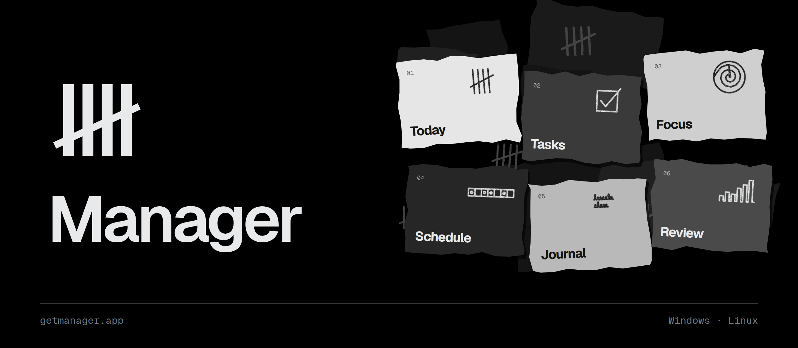
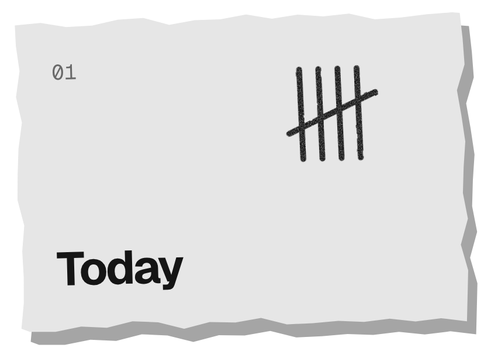
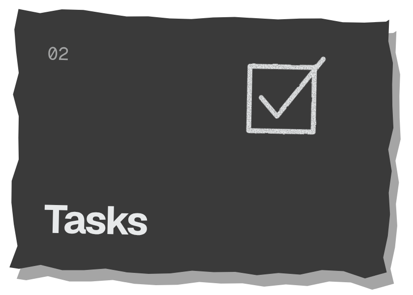
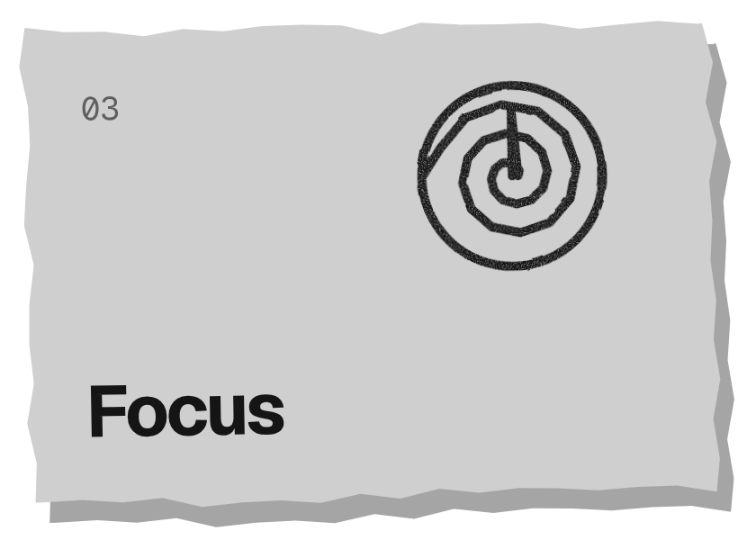
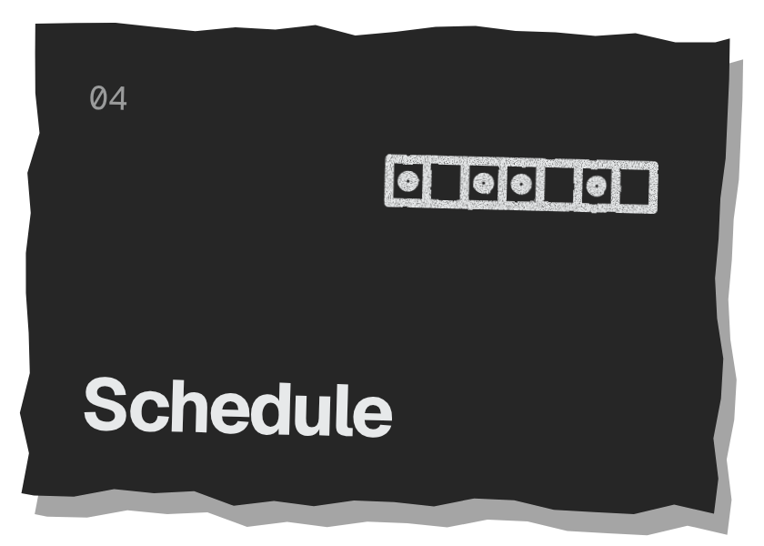
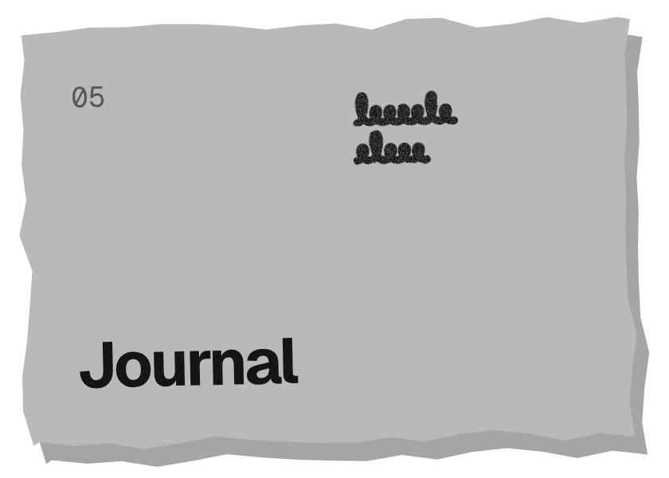
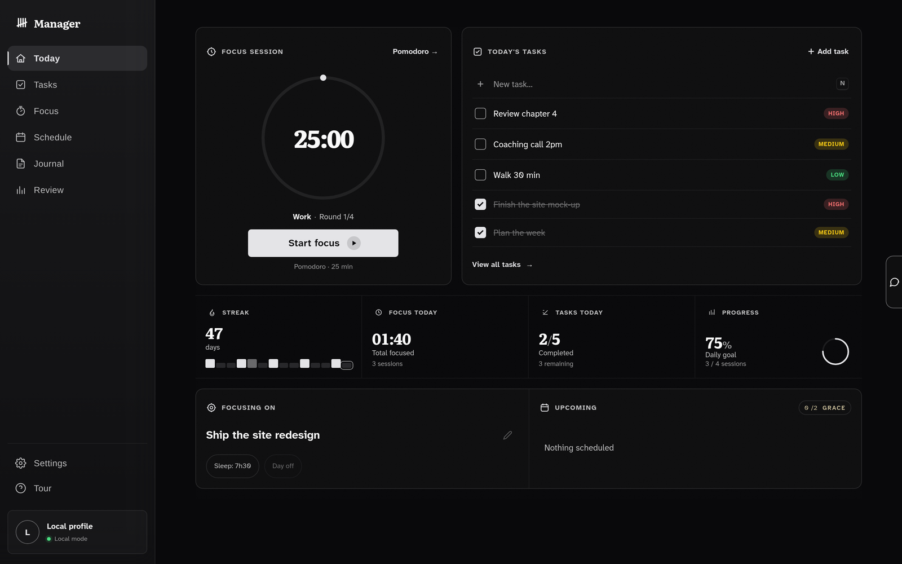

<p align="center">
  <a href="https://getmanager.app">
    
  </a>
</p>

<p align="center">
  <a href="../../releases/latest"></a>
  <a href="../../releases"></a>
  
  
</p>

<p align="center">
  <a href="https://getmanager.app"><b>getmanager.app</b></a>
  &nbsp;·&nbsp;
  <a href="../../releases/latest">Download</a>
  &nbsp;·&nbsp;
  <a href="https://getmanager.app/tour">Tour</a>
</p>

<br>

Official binary releases of **Manager**, a desktop app for focus, discipline and long-term consistency.

## Download

| Platform | Package | |
|---|---|---|
| **Windows** | `.exe` installer | [Latest release →](../../releases/latest) |
| **Debian / Ubuntu** | `.deb` | [Latest release →](../../releases/latest) |
| **Arch Linux** | AUR · `manager-bin` | `yay -S manager-bin` |

Once installed, Manager updates itself: new versions are signed and verified before they install.

## Inside

<table>
  <tr>
    <td width="33%" valign="top">
      <br>
      <sub>The day on one screen. Every day you hold adds a mark to the streak.</sub>
    </td>
    <td width="33%" valign="top">
      <br>
      <sub>One list per day, three priorities. Daily tasks repeat on their own.</sub>
    </td>
    <td width="33%" valign="top">
      <br>
      <sub>Pomodoro, Deep Work, Sprint, Flow or your own. Always-on-top widget.</sub>
    </td>
  </tr>
  <tr>
    <td width="33%" valign="top">
      <br>
      <sub>Your usual week in slots, checked in on the day.</sub>
    </td>
    <td width="33%" valign="top">
      <br>
      <sub>A few lines at night and a mood. What held, what slipped.</sub>
    </td>
    <td width="33%" valign="top">
      <br>
      <sub>7, 30 or 90 days: focus time, tasks done, days held, sleep.</sub>
    </td>
  </tr>
</table>

**Dona**, the AI coach, is built in: bring your own key or subscribe to Dona Plus.
Your data stays in a local file on your machine; sync is optional.

<p align="center">
  
</p>

## Installation

<details>
<summary><b>Windows</b></summary>
<br>

Download `Manager_x.x.x_x64-setup.exe` from the [latest release](../../releases/latest) and run it.

</details>

<details>
<summary><b>Debian / Ubuntu</b></summary>
<br>

Download `Manager_x.x.x_amd64.deb` from the [latest release](../../releases/latest), then:

```bash
sudo apt install ./Manager_x.x.x_amd64.deb
```

</details>

<details>
<summary><b>Arch Linux (AUR)</b></summary>
<br>

```bash
yay -S manager-bin
```

The AUR package is community-maintained and may lag a few versions behind.

</details>

## Requirements

| Platform | Dependencies |
|---|---|
| Windows | None (self-contained installer) |
| Debian / Ubuntu | `libwebkit2gtk-4.1`, `libgtk-3-0`, `libayatana-appindicator3-1` |
| Arch Linux | `webkit2gtk-4.1`, `gtk3`, `libayatana-appindicator` |

## License

© 2026 JAuxance. All rights reserved.
This software is proprietary. Redistribution or modification is not permitted without prior written consent.
